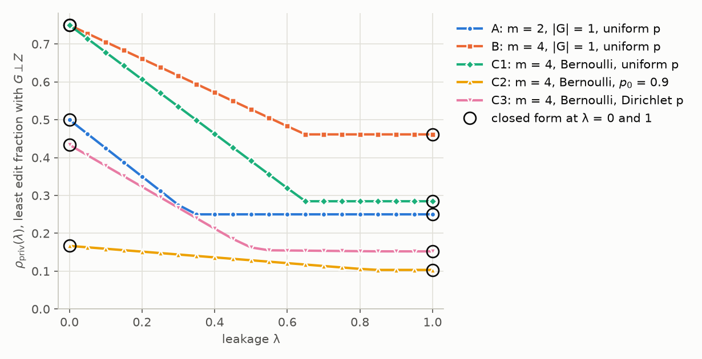
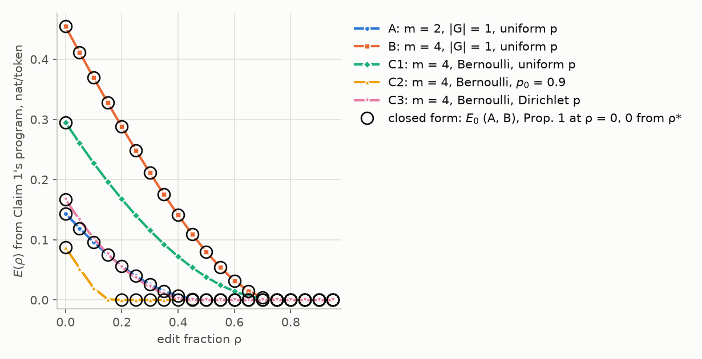
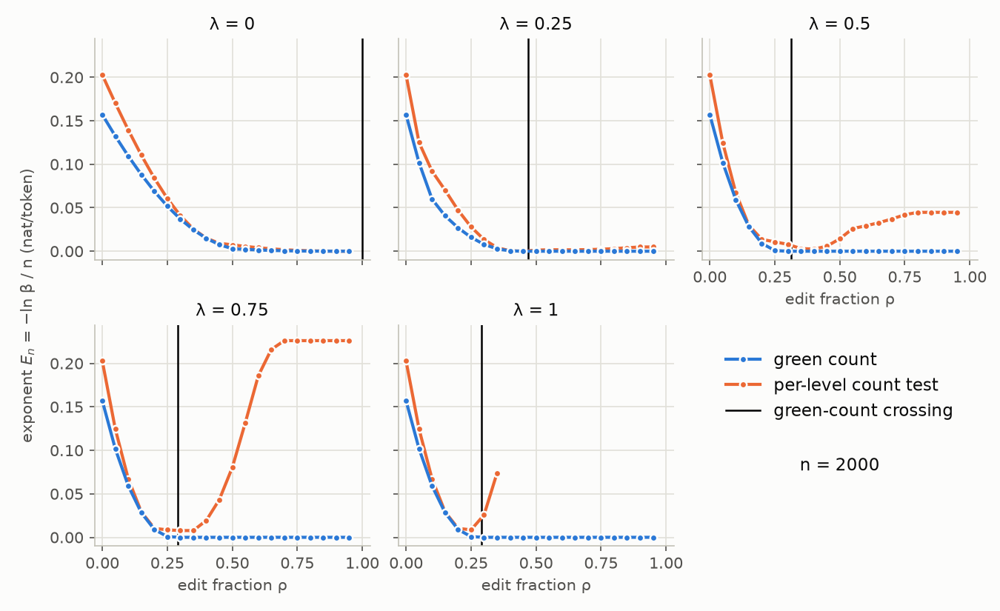
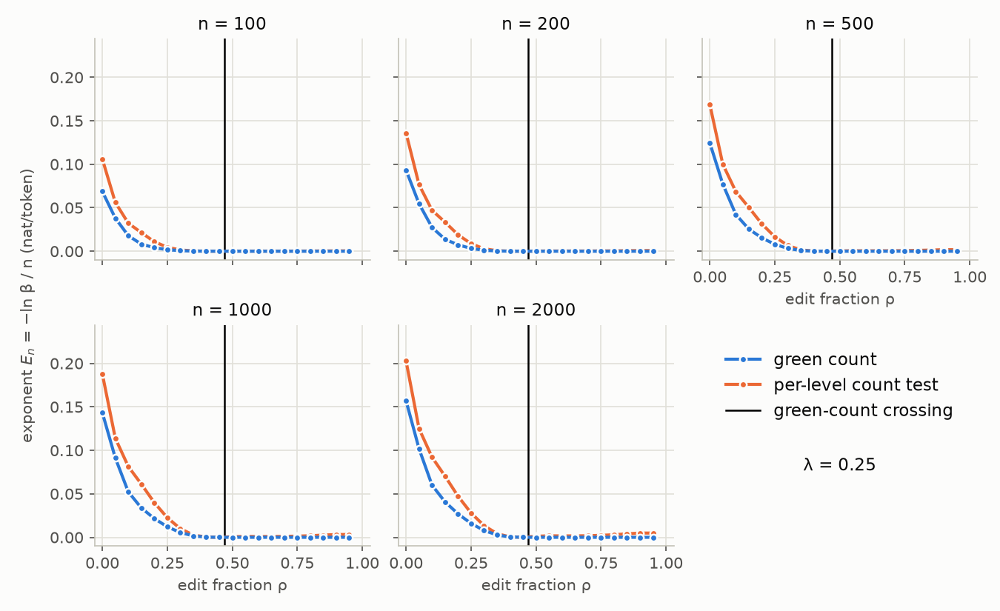

# watermark-edits

Exact numerical checks of the theory of green-list text watermarks under substitution attacks.

A green-list watermark (Kirchenbauer et al. 2023) raises the logits of a secret subset of the vocabulary at every
position; a detector that holds the key decides whether a text carries the watermark. The project report ("Text
watermark detection under edits") asks how fast the best detector's miss rate can fall with text length when an
attacker has replaced a fraction rho of the tokens, and at which rho it stops falling. This repository puts numbers
on that theory in two parts. `code/report_checks.py` recomputes the report's formulas on small instances, where every
probability is a finite sum or a small linear program, and `code/claim1_program.py` solves the report's variational
program for the exponent on the same instances. `code/exponent_greenlist.py` computes miss rates down to 10^-700 for
two fixed detectors in a larger token model with two entropy levels, an instance the report does not contain.

## What is computed

Setting. A generator emits tokens from a next-token law p over a vocabulary. The key is a sequence of independent
green lists G_t: each token is green with probability gamma (Bernoulli lists), or every list has exactly k of the m
tokens (gamma = k/m). The watermarked token is drawn from p~(v) proportional to p(v) e^{delta 1[v in G_t]}. The
attacker makes at most floor(rho n) substitutions and may choose them from the whole text. It is key-blind (it knows
gamma, delta and p but not the key), or it also sees G_t at each position independently with probability lambda, or
it is fully informed (lambda = 1). The detector knows the key, sees the edited text, and keeps its false-positive
rate at or below alpha on every text written without the key.

Quantities. beta*_n(alpha, rho) is the smallest miss rate a detector can guarantee at length n against every
admissible attack. E(rho) = liminf -(1/n) ln beta*_n is the minimax exponent, and rho* = sup{rho : E(rho) > 0} is the
critical edit fraction, past which more text no longer helps any detector. With leakage the report locates the
transition at rho_priv(lambda), the cost of the cheapest editing channel whose output is independent of the key.

### Part 1: the report's statements

`report_checks.py` tests statements K1 to K7 on the instances listed in the diagram below; all 64 rows pass at seed 0.
`claim1_program.py` solves the program of K8; all 299 rows pass at seed 0.

| check | statement | how it is checked |
|---|---|---|
| K1 | Prop. 1: with no edits, E(0) = E ln[1 + (e^delta - 1) p(G)] - delta gamma | the identity D(mu x Q \|\| P_GY) = D(Q \|\| p) + E(0) on 1000 random Q |
| K2 | Cor. 1: the key-blind rho* is 1 - max_z P_Y(z), the cost of overwriting the text with the likeliest token | linear program over editing channels, also with restricted replacement sets |
| K3 | q = P(emitted token green) and r = P(a blind replacement is green) < gamma in the symmetric example | enumeration over the lists |
| K4 | Inequality (2): q_t >= gamma + (1 - e^-delta) gamma (1 - gamma) (1 - sum_v p_t(v)^2) | 1000 random instances |
| K5 | Key-blind exponent E_0(rho) and rho_0* = (m - 1)/m in the symmetric example | exact green-count miss rates at n = 2000 and 10 000 |
| K6 | Informed exponent E_1(rho) = D(Bern(gamma + rho) \|\| Bern(q)) and rho_1* = q - gamma | the same |
| K7 | Claim 3: the leakage curve rho_priv(lambda) | linear program at lambda = 0, 0.05, ..., 1 |
| K8 | Claim 1: E(rho) is the minimum of D(Q_GY \|\| P_GY) + I_Q(G; Z \| Y) over Q(G, Y, Z) with Q_GZ = mu x Q_Z and Q(Y != Z) <= rho | solved numerically, then compared with E_0 of K5, Prop. 1, zero from rho* on, and section 3.5's bound |

Two results of the K1 to K7 run are not stated in the report:

- The full-leakage threshold q - gamma, which the report gives for its symmetric example, also holds on the three
  instances with Bernoulli lists, including the two with non-uniform p.
- Every rho_priv curve reaches q - gamma before lambda = 1: at grid lambda 0.35 on A, 0.65 on B and C1, 0.85 on C2
  and 0.9 on C3. On A the linear program returns max(1/4, 1/2 - 3 lambda/4) at every grid lambda.

The solved program of K8 agrees with every closed form it is compared with. On A and B it equals E_0 within 1.0e-10
at every grid rho, so Claim 1 reproduces the symmetric example. With Bernoulli lists the optimum sits well above the
green-count bound D(Bern(gamma + rho) || Bern(q)) of section 3.5: on C1 at rho = 0 it is 0.2952 against 0.1679
nat/token.

### Part 2: the two-level model

`exponent_greenlist.py` fixes one attack rule and two detectors and computes beta_n(alpha, rho, lambda), the miss rate
at length n, and E_n = -ln beta_n / n, its finite-n exponent. The detectors are the green count and the per-level
count test: the Neyman-Pearson test on the per-level green counts, which knows the attack rule and each position's
entropy level but not which positions were edited. Closed-form comparisons: the Cramer rate function at the finite-n
threshold, the KL lower bound D(Bern(gamma) || Bern(qbar)), and the green-count crossing.

The green-count crossing answers one question: at what edit fraction does more text stop helping the green count
against this attack rule? It is the rho at which the mean green rate reaches gamma, and it depends on gamma, delta, pi
and lambda, not on n or alpha. It is not the report's rho*. The attack rule here replaces tokens without looking at
the text, which is weaker than the key-blind attacker of the setting above, and the per-level count test is a ceiling
for tests that use those counts, not for every detector. A text-aware attack rule for this model is the next round.

## Install

Requires Python 3.13 (pinned in .python-version) and [uv](https://docs.astral.sh/uv/).

```bash
uv sync
```

This creates .venv with the versions pinned in uv.lock (numpy 2.5.4, scipy 1.18.1, matplotlib 3.11.2). Without uv,
any recent numpy, scipy and matplotlib work; only the two Monte Carlo numbers (q_L and the diagnostic) can then differ
in the fourth decimal.

## Usage

Part 1, checks K1 to K7, runs in about a second:

```bash
uv run python code/report_checks.py --seed 0
```

| flag | default | meaning |
|---|---|---|
| `--alpha` | 1e-3 | false-positive rate of the green-count test in K5 and K6 |
| `--n-list` | 2000 10000 | text lengths; the exponent rules compare the smallest with the largest |
| `--rho-grid` | 0 0.05 ... 0.95 | edit fractions in K5 and K6 |
| `--lambda-step` | 0.05 | step of the leakage grid in K7 |
| `--seed` | 0 | seed of C3's p, K1's random Q and K4's draws |
| `--out` | data | output root |

Numbers to expect (seed 0):

| quantity | value |
|---|---|
| rows passing | 64 of 64 (K1 10, K2 7, K3 6, K4 1, K5 12, K6 8, K7 20) |
| E(0) by Prop. 1 on A, B, C1, C2, C3 | 0.1438, 0.4545, 0.2952, 0.0875, 0.1671 |
| key-blind rho* on C1, C2, C3, linear program and closed form | 0.7500, 0.1667, 0.4338 |
| q and r on A; on B | 0.75 and 0.25; 0.7112 and 0.0963 |
| rho_priv at lambda = 0, 0.25, 0.5, 0.75, 1 on A | 0.5, 0.3125, 0.25, 0.25, 0.25 |
| the same on B | 0.75, 0.6387, 0.5274, 0.4612, 0.4612 |
| the same on C1 | 0.75, 0.5706, 0.3912, 0.2846, 0.2846 |
| the same on C2 | 0.1667, 0.1477, 0.1287, 0.1098, 0.1032 |
| the same on C3 | 0.4338, 0.2952, 0.1627, 0.1532, 0.1522 |
| worst gap between E_2000 and the rate at its threshold | 4.0 % (E_0 on A, rho = 0.15) |
| gap to the limit at n = 10 000 over the gap at n = 2000, largest | 0.52 |

Part 1, check K8, takes about 14 seconds:

```bash
uv run python code/claim1_program.py --seed 0
```

| flag | default | meaning |
|---|---|---|
| `--rho-grid` | 0 0.05 ... 0.95 | edit fractions |
| `--seed` | 0 | seed of C3's p, the random Q of the identity rows and the random starts |
| `--out` | data | output root |

Numbers to expect (seed 0):

| quantity | value |
|---|---|
| rows passing | 299 of 299 (K8a 15, K8b 5, K8c 25, K8d 10, K8e 15, K8f 29, K8g 100, K8h 100) |
| E(rho) at rho = 0, 0.25, 0.5, 0.75 on A | 0.1438, 0.0398, 0, 0 |
| the same on B | 0.4545, 0.2489, 0.0801, 0 |
| the same on C1 | 0.2952, 0.1405, 0.0381, 0 |
| the same on C2 | 0.0875, 0, 0, 0 |
| the same on C3 | 0.1671, 0.0362, 0, 0 |
| worst gap to E_0 over the grid on A; on B | 1.0e-10; 1.0e-11 |
| largest gap bound of the solver; largest spread between the three starts | 9e-10; 2.7e-15 |
| run time on A, B, C1, C2, C3 | 0.36 s, 0.68 s, 4.0 s, 3.6 s, 4.2 s |

Part 2 takes about ten seconds:

```bash
uv run python code/exponent_greenlist.py --seed 0
```

The default run covers rho in {0, 0.05, ..., 0.95}, lambda in {0, 0.25, 0.5, 0.75, 1} and n in {100, 200, 500, 1000,
2000}, plus n = 10 000 at lambda = 0. Every flag has a default:

| flag | default | meaning |
|---|---|---|
| `--gamma` | 0.25 | green fraction |
| `--delta` | 2.0 | logit bias on green tokens |
| `--V` | 50000 | vocabulary size |
| `--pi` | 0.5 | probability that a position is high entropy (uniform over V); otherwise top token 0.9 |
| `--alpha` | 1e-3 | false-positive rate the threshold is calibrated to |
| `--rho-grid` | 0 0.05 ... 0.95 | edit fractions |
| `--lambda-grid` | 0 0.25 0.5 0.75 1 | leakage probabilities |
| `--n-list` | 100 200 500 1000 2000 | text lengths (n = 10 000 is added at lambda = 0) |
| `--fixed-lambda` | 0.25 | leakage held fixed in the second figure; must be in `--lambda-grid` |
| `--trials` | 100000 | Monte Carlo key draws for q_L and the diagnostic |
| `--seed` | 0 | seed of the Monte Carlo parts; everything else is deterministic |
| `--out` | data | output root |

Numbers to expect at the defaults (seed 0):

| quantity | value |
|---|---|
| q_H, q_L, qbar | 0.7112, 0.3669, 0.5391 |
| E_2000 at rho = 0 (green count) | 0.1570; 0.1775 at n = 10 000; limit I(gamma) = 0.1955 |
| green-count crossing for lambda = 0, 0.25, 0.5, 0.75, 1 | 1.000, 0.469, 0.312, 0.289, 0.289 |
| green-count miss rate at lambda = 0, rho = 0.75 | 0.56 at n = 2000, 0.0002 at n = 10 000 |
| P(top token green given a tail token was emitted), spike level | 0.0530 (closed form), 0.0523 (Monte Carlo) |

`diagnostic.json` also records seven self-checks (outputs exist; E_n > 0 at lambda = 0; E_2000 within 5 % of the rate
at the finite-n threshold where -ln beta_2000 >= 100; the n = 10 000 exponent closer to the limit; below the crossing,
beta falling from the smallest to the largest n, and above it beta_2000 >= 0.999; the per-level count test never
weaker than the green count; the diagnostic reported). All pass at the defaults.

## Figures

Part 1. The critical edit fraction rho_priv against the leakage lambda, one curve per instance. Black rings mark the
closed forms at lambda = 0 (Cor. 1, or (m - 1)/m with fixed-size lists) and at lambda = 1 (q - gamma). Each curve
falls and then stays at q - gamma before lambda reaches 1.



The minimax exponent E(rho) from Claim 1's program, one curve per instance. Black rings mark the report's closed
forms: E_0 on A and B, Prop. 1 at rho = 0, and zero from rho* on.



Part 2. Both figures plot the exponent E_n = -ln beta_n / n against the edit fraction rho. Every panel has two curves,
the green count and the per-level count test, and a solid black line at the green-count crossing. Higher is better for
the detector, and zero means that length of text no longer helps. At these lengths the green count falls to about zero
before the line, because the fixed-alpha threshold sits above gamma. The line does not move with n: at lambda = 0.25
it is at 0.469 in every panel.

Fixed document length, n = 2000, with one panel per leakage level lambda:



Fixed leakage, lambda = 0.25, with one panel per document length n:



Where the per-level count test stays above zero after the green count reaches it, this attack rule has left the two
entropy levels at different green rates, or has turned the text too red. Its curve stops early at lambda = 1 because
its miss rate is exactly zero from there on.

## Layout and workflow

The spine of the diagram follows the report: the model, then one block per statement with the check that tests it.
The two-level model hangs below as an extension; its blocks name the paper each choice comes from and the file that
implements it.

```
 watermark-edits/
 +-- README.md
 +-- pyproject.toml, uv.lock, .python-version   numpy, scipy, matplotlib; 3.13
 +-- code/report_checks.py                      part 1: checks K1-K7, figure
 +-- code/claim1_program.py                     part 1: check K8, figure
 +-- code/exponent_greenlist.py                 part 2: main loop, two figures
 +-- code/wmsim/                                singlepos.py, util.py,
 |                                              tokenmodel.py, attack.py,
 |                                              greencount.py, oraclenp.py,
 |                                              exponent.py
 +-- data/             created by the runs, untracked: csv, json, png
 +-- results/figures/  created by the runs, untracked: copies of the figures
 +-- figures/          tracked copies of the four figures shown above

 question:  beta*_n = the miss rate of the best detector against its
                      worst attack, at false-positive level alpha
            E(rho)  = liminf -(1/n) ln beta*_n
            rho*    = sup of the rho with E(rho) > 0
         |
         v
 +-- MODEL (report sec. 2) --------------------------------------------------+
 |  Key: one green list G_t per position, independent. Bernoulli lists       |
 |  (each token green w.p. gamma) or lists of exactly k tokens.              |
 |  Text: token drawn from p~(v) prop. to p(v) e^{delta 1[v in G_t]}.        |
 |  Attack: at most floor(rho n) substitutions, chosen from the text.        |
 |  Detector: any test of (text, key) whose false-positive rate is at        |
 |  most alpha on every text written without the key.                        |
 |  code: wmsim/singlepos.py, law() (one position, by enumeration)           |
 +---------------------------------------------------------------------------+
         |
         v
 +-- WHAT THE ATTACKER KNOWS (report sec. 3.3, 3.4) -------------------------+
 |  lambda = 0   key-blind: gamma, delta and p, not the key                  |
 |  0 < lambda   also sees G_t at each position w.p. lambda                  |
 |  lambda = 1   fully informed                                              |
 +---------------------------------------------------------------------------+
         |
         v
 +-- INSTANCES (m tokens) ---------------------------------------------------+
 |  A   m = 2, lists of 1 token (gamma = 1/2), e^delta = 3, uniform p;       |
 |      the report's example                                                 |
 |  B   m = 4, lists of 1 token (gamma = 1/4), delta = 2, uniform p          |
 |  C1  m = 4, Bernoulli lists, gamma = 1/4, delta = 2, uniform p            |
 |  C2  as C1 with p = (0.9, 1/30, 1/30, 1/30)                               |
 |  C3  as C1 with p drawn from Dirichlet(1, 1, 1, 1), seed 0                |
 +---------------------------------------------------------------------------+
         |
         v
 +-- K1  NO EDITS: PROP. 1 (sec. 3.1) ---------------------------------------+
 |  E(0) = E ln[1 + (e^delta - 1) p(G)] - delta gamma                        |
 |  check: D(mu x Q || P_GY) = D(Q || p) + E(0) for 1000 random Q,           |
 |         to 1e-12                                                          |
 |  on:    A, B, C1, C2, C3                                                  |
 +---------------------------------------------------------------------------+
         |
         v
 +-- K2  KEY-BLIND CRITICAL FRACTION: COR. 1 (sec. 3.2) ---------------------+
 |  rho* = 1 - max_z P_Y(z). A channel whose output is independent of        |
 |  the key must ignore its input, so the cheapest one overwrites the        |
 |  text with the likeliest token.                                           |
 |  check: linear program over channels A(z|y), to 1e-8; also with           |
 |         restricted replacement sets (infeasible when no token may         |
 |         replace every other)                                              |
 |  on:    C1, C2, C3                                                        |
 +---------------------------------------------------------------------------+
         |
         v
 +-- K3 K5 K6  SYMMETRIC EXAMPLE (sec. 3.3) ---------------------------------+
 |  Uniform p, lists of exactly k tokens. q = P(emitted token green),        |
 |  r = P(a blind replacement is green) = (k - q)/(m - 1) < gamma.           |
 |  key-blind: E_0(rho) = Cramer rate at gamma of                            |
 |             Bin((1 - rho) n, q) + Bin(rho n, r);  rho_0* = (m - 1)/m      |
 |  informed:  E_1(rho) = D(Bern(gamma + rho) || Bern(q));                   |
 |             rho_1* = q - gamma                                            |
 |  check: exact green-count miss rates at n = 2000 and 10 000 against       |
 |         the rate at each n's threshold and against the limit              |
 |  on:    A, B                                                              |
 +---------------------------------------------------------------------------+
         |
         v
 +-- K7  LEAKAGE: CLAIM 3 (sec. 3.4) ----------------------------------------+
 |  rho_priv(lambda) = cost of the cheapest channel, given the leaked        |
 |  lists, whose output is independent of the key.                           |
 |  check: linear program at lambda = 0, 0.05, ..., 1, to 1e-8; equals       |
 |         K2 at lambda = 0 and q - gamma at lambda = 1; never rises;        |
 |         never below q - gamma                                             |
 |  on:    A, B, C1, C2, C3          figure: rho_priv_vs_lambda.png          |
 +---------------------------------------------------------------------------+
         |
         v
 +-- K4  INEQUALITY (2) (sec. 3.5) ------------------------------------------+
 |  q_t >= gamma + (1 - e^-delta) gamma (1 - gamma) (1 - sum p_t(v)^2)       |
 |  check: 1000 random (m, p, gamma, delta) with Bernoulli lists             |
 +---------------------------------------------------------------------------+
         |
         v
 +-- K8  THE EXPONENT: CLAIM 1 (sec. 3.1) -----------------------------------+
 |  E(rho) = min over Q(G, Y, Z) of D(Q_GY || P_GY) + I_Q(G; Z | Y)          |
 |  subject to Q_GZ = mu x Q_Z and Q(Y != Z) <= rho.                         |
 |  check: solved by a barrier Newton method from three starts, to           |
 |         1e-6, and compared with E_0 of K5 on A and B, with K1 at          |
 |         rho = 0, with zero from rho* on, and with sec. 3.5's bound        |
 |         D(Bern(gamma + rho) || Bern(q))                                   |
 |  on:    A, B, C1, C2, C3          figure: claim1_exponent.png             |
 |  code:  claim1_program.py                                                 |
 +---------------------------------------------------------------------------+
         |
         v
 +-- OUTPUTS OF report_checks.py (K1 to K7) ---------------------------------+
 |  data/results/2026-11-12-report-checks/                                   |
 |    checks.csv      one row per statement and instance: value,             |
 |                    reference, difference, tolerance, pass                 |
 |    exponents.csv   beta_n, E_n, the rate at the threshold and the         |
 |                    limit, per instance, n and rho                         |
 |    rho_priv.csv    rho_priv per instance and lambda                       |
 |    diagnostic.json instances, pass counts, parameters                     |
 |  data/figures/<slug>/rho_priv_vs_lambda.png, copied to figures/           |
 +---------------------------------------------------------------------------+
         |
         v
 +-- OUTPUTS OF claim1_program.py (K8) --------------------------------------+
 |  data/results/2026-11-12-claim1-program/                                  |
 |    checks.csv      one row per comparison: value, reference,              |
 |                    difference, tolerance, pass                            |
 |    claim1.csv      E(rho) per instance and rho, with the solver's         |
 |                    gap bound, constraint violation and start spread       |
 |    diagnostic.json instances, pass counts, solver times                   |
 |  data/figures/<slug>/claim1_exponent.png, copied to figures/              |
 +---------------------------------------------------------------------------+
         :
         :  extension, not in the report: the same key, budget and
         :  leakage in a larger token model, for two fixed detectors
         v
 +-- TWO-LEVEL TOKEN MODEL --------------------------------------------------+
 |  i.i.d. positions: uniform over V = 50 000 w.p. pi = 0.5,                 |
 |  otherwise top token 0.9 and the rest uniform.                            |
 |  lit:  Li et al. 2025 sec. 5.1 (synthetic spike distributions);           |
 |        Kirchenbauer et al. 2023 Thm 4.2 (entropy)                         |
 |  code: wmsim/tokenmodel.py                                                |
 +---------------------------------------------------------------------------+
         |
         v
 +-- KEY AND LEAKAGE --------------------------------------------------------+
 |  Fresh list per position, each token green w.p. gamma.                    |
 |  The attacker sees G_t w.p. lambda.                                       |
 |  lit:  Kirchenbauer et al. 2023 (scheme); Zhao et al. 2024 App. D         |
 |        (what hashing would add); Zhang et al. 2024, Jovanovic et al.      |
 |        2024 (list recovery from the API: the realistic lambda range)      |
 |  code: gamma enters wmsim/greencount.py and wmsim/oraclenp.py;            |
 |        keys are drawn only in wmsim/tokenmodel.py                         |
 +---------------------------------------------------------------------------+
         |
         v
 +-- GREEN PROBABILITY PER LEVEL --------------------------------------------+
 |  q_H = 0.711 (uniform), q_L = 0.367 (spike);                              |
 |  diagnostic P(top token green | tail token emitted) = 0.053               |
 |  lit:  Kirchenbauer et al. 2023 sec. 3 (the tilt);                        |
 |        Jensen on g(x) = e^delta x / (e^delta x + 1 - x)                   |
 |  code: wmsim/tokenmodel.py                                                |
 +---------------------------------------------------------------------------+
         |
         v
 +-- ATTACK RULE ------------------------------------------------------------+
 |  Budget floor(rho n): leaked greens -> red (one edit each), then          |
 |  unleaked uniform positions, then spike; replacement green w.p.           |
 |  gamma where the list is unseen. The leaked-green count K is              |
 |  random and every law is the exact mixture over K.                        |
 |  The replacements ignore the text, so this rule is weaker than the        |
 |  key-blind attacker of K2.                                                |
 |  lit:  Wu and Chandrasekaran 2024 Thm 1 (colour-agnostic                  |
 |        replacement)                                                       |
 |  code: wmsim/attack.py (allocation, per K value and at its mean);         |
 |        wmsim/greencount.py and wmsim/oraclenp.py (exact mixture over K)   |
 +---------------------------------------------------------------------------+
         |
         v
 +-- DETECTORS (both see the same attacked text) ----------------------------+
 |  Green count, exact in log space: null Bin(n, gamma), threshold           |
 |  at alpha; alternative = binomial convolutions mixed over K.              |
 |  lit:  Kirchenbauer et al. 2023 z-test; Fernandez et al. 2023             |
 |        (exact tests at low false-positive rates)                          |
 |  code: wmsim/greencount.py                                                |
 |  - - - - - - - - - - - - - - - - - - - - - - - - - - - - - - - - - - - -  |
 |  Per-level count test, exact on the (S_H, S_L) grid: likelihood           |
 |  ratio on the per-level green counts; knows the attack rule and           |
 |  the levels, not the edited positions. A ceiling for tests that           |
 |  use these counts, not for every detector.                                |
 |  lit:  Neyman-Pearson lemma; Li et al. 2025 (detection                    |
 |        efficiency = exponent at fixed alpha)                              |
 |  code: wmsim/oraclenp.py                                                  |
 +---------------------------------------------------------------------------+
         |
         v
 +-- EXPONENT AND GREEN-COUNT CROSSING --------------------------------------+
 |  E_n = -ln beta_n / n for each detector, plotted against rho.             |
 |  Self-checks, not plotted: Cramer rate at tau_n/n, KL bound, beta by n.   |
 |  Green-count crossing = the edit fraction where the mean green rate       |
 |  reaches gamma under this attack rule; more text stops helping the        |
 |  green count there. Black line in the figures. It is not rho*.            |
 |  lit:  Cover and Thomas sec. 11.8 (Stein's lemma); Cramer's               |
 |        theorem; Hoeffding 1963 (KL form of the bound)                     |
 |  code: wmsim/exponent.py                                                  |
 +---------------------------------------------------------------------------+
         |
         v
 +-- OUTPUTS OF exponent_greenlist.py ---------------------------------------+
 |  data/results/2026-10-25-greenlist-substitution-exponent/                 |
 |    beta.csv        per (n, lambda, rho): threshold, exact sizes,          |
 |                    log10 beta, class counts                               |
 |    exponents.csv   E_gc, E_np (per-level count test), I_n(tau_n/n),       |
 |                    I_n(gamma), KL bound                                   |
 |    rhostar.csv     green-count crossing and the green rate per level      |
 |                    there, per lambda                                      |
 |    diagnostic.json q_H, q_L, spike diagnostic, self-checks, params        |
 |  data/figures/<slug>/, copied to results/figures/                         |
 |    exponent_fixed_length.png   n = 2000, one panel per lambda             |
 |    exponent_fixed_leakage.png  lambda = 0.25, one panel per n             |
 +---------------------------------------------------------------------------+
```

## Conventions

- Deterministic computation everywhere except the seeded draws: q_L and the diagnostic in part 2, which are Monte
  Carlo with their standard errors reported, and C3's p, K1's random Q and K4's instances in part 1.
- In part 1 an identity must hold to 1e-12 and a linear-program value to 1e-8. A grid rho that sits exactly on a
  threshold is reported without a pass rule.
- Claim 1's program is solved numerically, by a log-barrier Newton method with the exact Hessian. A solved value must
  match a closed form to 1e-6 and three starts must agree within 1e-7. Every cell must also end with a converged
  centring step (Newton decrement at most 1e-10, measured in the units of the objective) and a gap bound of at most
  1e-8.
- The threshold is calibrated to alpha on text written without the key (null = fresh random key), never assumed from a
  normal approximation; the realised sizes of the tests are written to beta.csv (part 2) and exponents.csv (part 1).
- The attack budget is exact: at most floor(rho n) substitutions, and the same two files record the number used.
- In part 2, level and leak counts are fixed at their expectations; the key stays random, so the number of greens the
  attacker can see is binomial and every law is the exact mixture over it. Cells where the per-level count test's miss
  rate is exactly zero are reported as such, not as a small number.

## References

- Kirchenbauer, J., Geiping, J., Wen, Y., Katz, J., Miers, I., Goldstein, T. (2023). A watermark for large language
  models. ICML 2023, PMLR 202:17061-17084.
- Li, X., Ruan, F., Wang, H., Long, Q., Su, W. J. (2025). A statistical framework of watermarks for large language
  models: pivot, detection efficiency and optimal rules. Annals of Statistics 53(1):322-351.
- Wu, Q., Chandrasekaran, V. (2024). Bypassing LLM watermarks with color-aware substitutions. ACL 2024, 8549-8581.
- Zhao, X., Ananth, P., Li, L., Wang, Y.-X. (2024). Provable robust watermarking for AI-generated text. ICLR 2024.
- Fernandez, P., Chaffin, A., Tit, K., Chappelier, V., Furon, T. (2023). Three bricks to consolidate watermarks for
  large language models. IEEE WIFS 2023.
- Zhang, Z. et al. (2024). Large language model watermark stealing with mixed integer programming. ACSAC 2024, 46-60.
- Jovanovic, N., Staab, R., Vechev, M. (2024). Watermark stealing in large language models. ICML 2024.
- Cover, T. M., Thomas, J. A. (2006). Elements of Information Theory, 2nd ed., sec. 11.8 (Chernoff-Stein lemma).
- Hoeffding, W. (1963). Probability inequalities for sums of bounded random variables. JASA 58(301):13-30.
